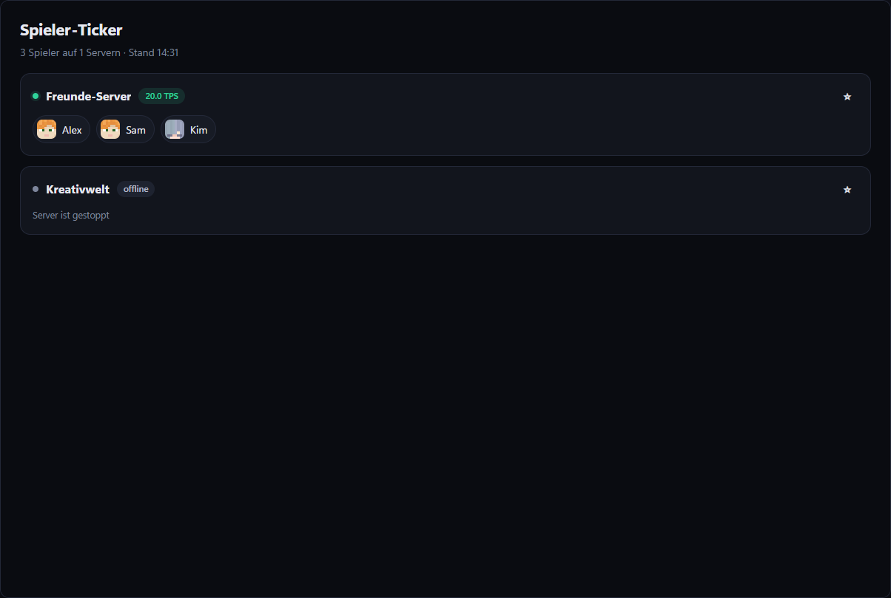

# Spieler-Ticker

[English](README.md) · **Deutsch**

Wer ist gerade auf deinen Minecraft-Servern? Live-Liste mit Köpfen, TPS und Spielzeit-Rangliste – schön für Streams und Discord-Bildschirme. Mit Kachel für die Übersicht.

## Funktionen

- Live-Spielerliste mit Köpfen – aktualisiert sich, sobald jemand kommt oder geht
- TPS je Server, gestoppte Server wahlweise
- Spielzeit-Rangliste (Top 3/5/10, einstellbar)
- Lieblingsserver oben anheften (bleibt gespeichert)
- Kachel „Spieler online“ für die Übersicht
- Deutsch und Englisch, hell und dunkel

## Installieren

In Hostwerk (ab 2.9): **Apps → Erweiterungen → Marktplatz → Spieler-Ticker → Installieren** (Abzeichen *Offiziell*).
Oder von Hand: `player-ticker-1.0.0.zip` aus dem [neuesten Release](../../releases/latest) laden → *Apps → Erweiterungen → Datei*.

## Rechte

- `read:services`, `read:minecraft` – Server und Spieler sehen
- `storage` – angehefteten Server merken

Läuft in Hostwerk abgeschottet – kein Zugriff auf Anmeldungen, Einstellungen oder Dateien.

## Selbst bauen

Dieses Repository ist auch ein Beispiel für das [Hostwerk-Erweiterungs-SDK](https://github.com/Passimoritz/hostwerk-public/blob/main/sdk/README.de.md): Design-Baukasten, Übersetzungen, Einstellungen, Speicher, Ereignisse, Prüfung und Releases.

Lizenz: MIT
