# Player Ticker

**English** · [Deutsch](README.de.md)

Who is on your Minecraft servers right now? A live list with player heads, TPS and a playtime ranking – great for streams and Discord screens. Includes a dashboard tile.

| Dark | Light |
|---|---|
|  |  |

## Features

- Live player list with heads, updates the moment someone joins or leaves
- TPS per server, stopped servers optional
- Playtime ranking (top 3/5/10, configurable)
- Pin your favourite server to the top (kept across restarts)
- Dashboard tile “Players online”
- German and English, light and dark mode

## Install

In Hostwerk (2.9 or newer): **Apps → Extensions → Marketplace → Player Ticker → Install** (badge *Official*).
Or manually: download `player-ticker-1.0.0.zip` from the [latest release](../../releases/latest) → *Apps → Extensions → File*.

## Permissions

- `read:services`, `read:minecraft` – see servers and players
- `storage` – remember the pinned server

Runs sandboxed in Hostwerk – no access to logins, settings or files.

## Build your own

This repository is also an example for the [Hostwerk extension SDK](https://github.com/Passimoritz/hostwerk-public/blob/main/sdk/README.md): design kit, translations, settings, storage, events, check and releases.

License: MIT
